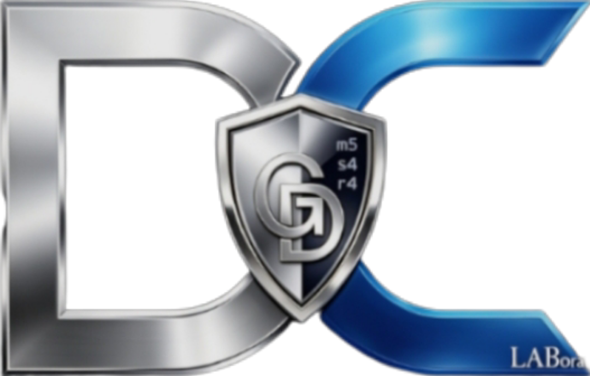
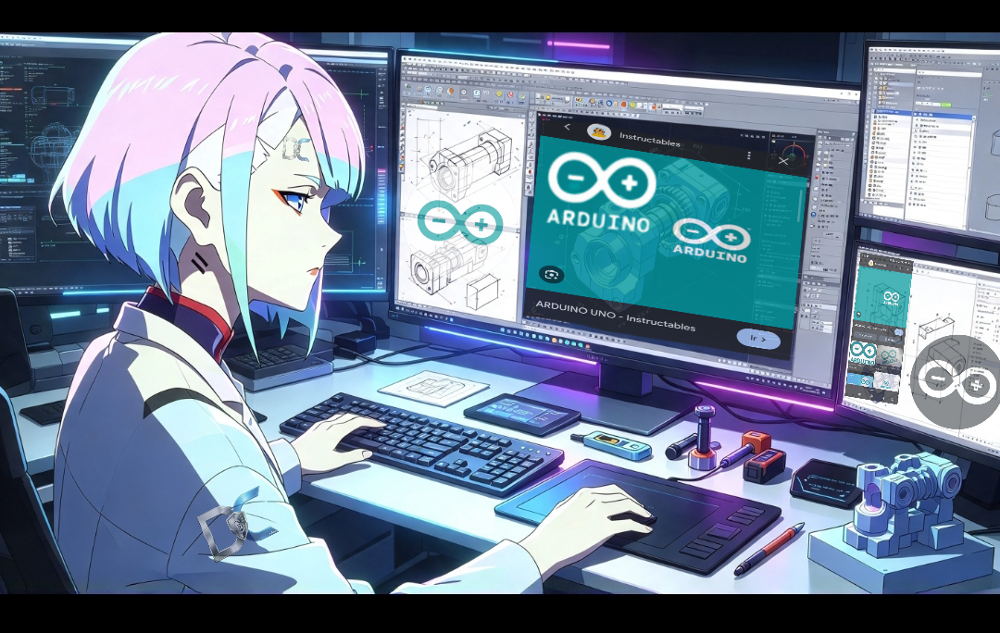
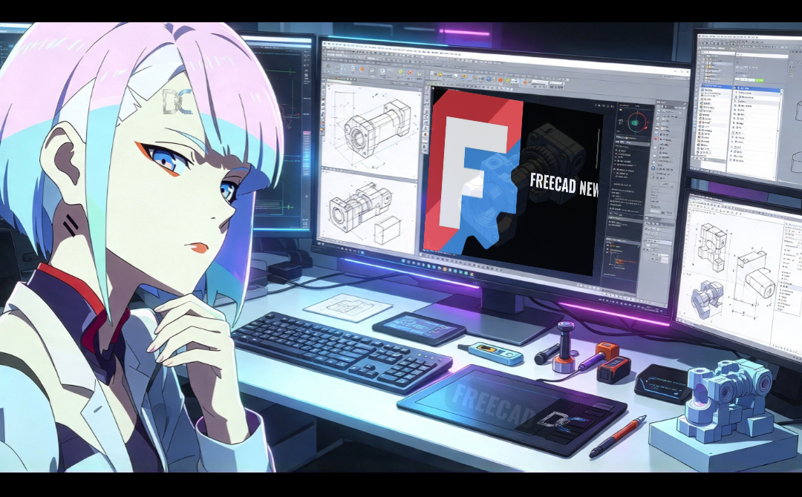
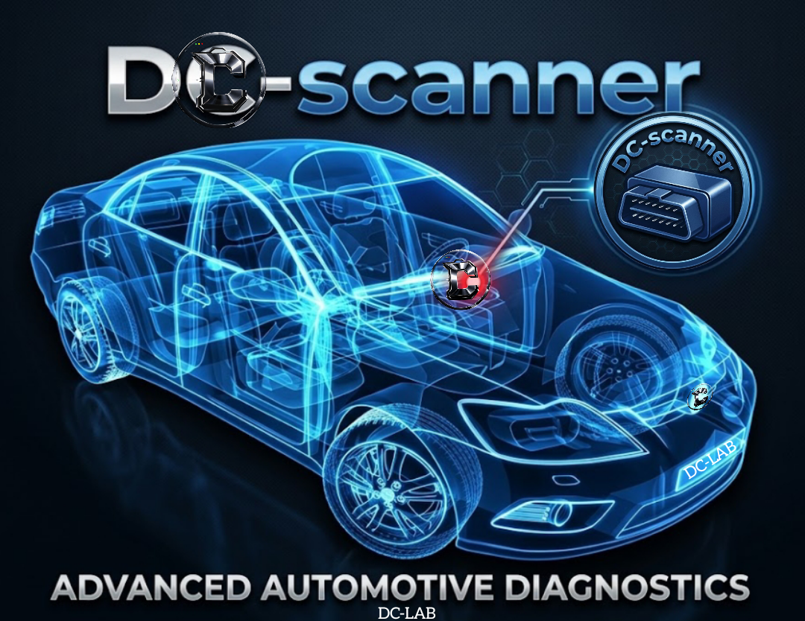
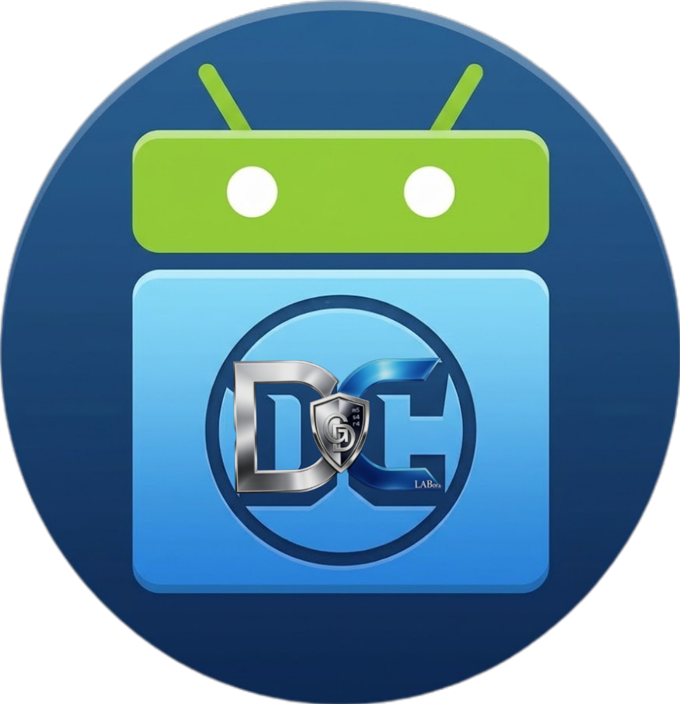
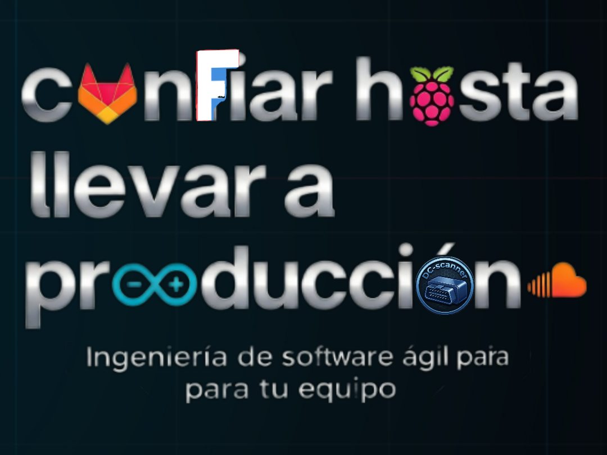
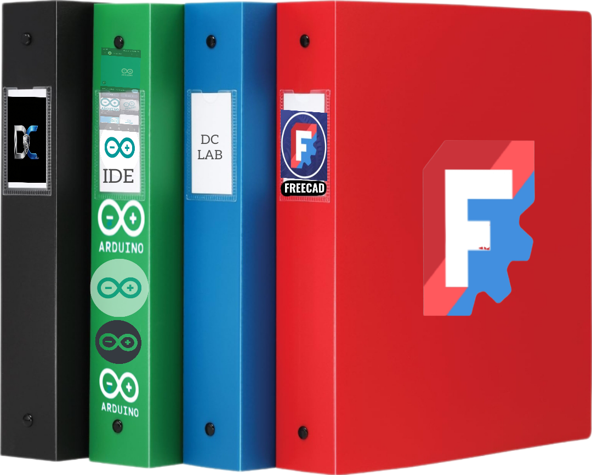
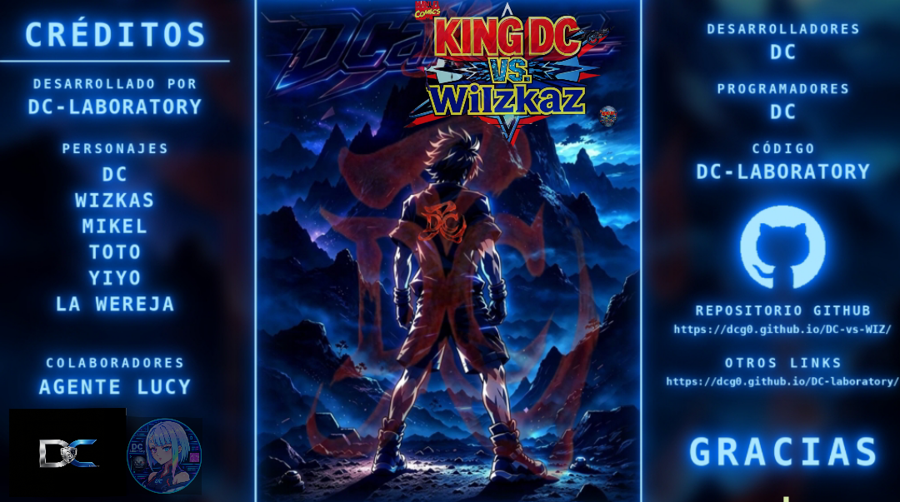
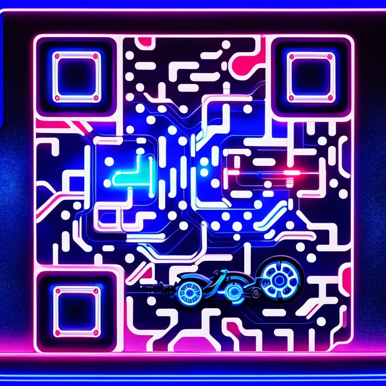

#🌐DC-LABORATORY // EL-LABORATORIO🌐
🔗**[https://dcg0.github.io/El-laboratorio/]
<p align="center">
  
</p>

<p align="center">
  <b>Centro de Investigación, Desarrollo y Taller de Ingeniería Inversa, Sistemas Embebidos y Automatización Automotriz</b>
</p>

<p align="center">
  <a href="https://dcg0.github.io/DC-laboratory/"></a>
  
  
  
</p>

---

## 📌 Visión General

**DC-Laboratory** es el núcleo de desarrollo de software embebido, telemática vehicular, agentes de inteligencia artificial y herramientas de diagnóstico avanzado para motores (enfocado principalmente en ecosistemas Volkswagen y ECUs programables como **Speeduino**).

En este repositorio convergemos el desarrollo de firmware en **C++ (arduino-cli)**, aplicaciones híbridas, monitoreo en tiempo real vía **OBD2/ELM327**, interfaces web con renderizado en **Canvas**, y pipelines de integración continua.

---

## 🛠️ Estructura del Laboratorio y Talleres de Desarrollo

### 1. 🤖 Taller de Inteligencia Artificial & Agentes (`/lucy`)
Desarrollo y personalización de agentes autónomos locales ejecutados bajo entornos Ollama.
* **Agente Lucy (`SOUL.md` & `Modelfile`):** Configuración de personalidad, contexto técnico y automatización de procesos para asistencia en diagnóstico y programación.
* **Integración Local:** Modelos optimizados para ejecución eficiente en arquitectura host ( Dual-Core, 16GB RAM) y nodos secundarios en red T.

<p align="center">
  
  
</p>

---

### 2. 🚗 Taller de Telemática & Diagnóstico ECU (`/DC-ELM327` / `/DCvsWIZ`)
Investigación profunda e ingeniería inversa en protocolos de comunicación automotriz (ISO 9141-2, K-Line, CAN Bus, OBD2).

<p align="center">
  
  
</p>

* **DC-scanner:** Herramienta de escaneo y telemetría en tiempo real con capacidad de análisis de código de falla (DTC), lectura de sensores y generación de gráficos en Canvas.
* **Speeduino Integration:** Creación y ajuste de mapas de inyección/ignición, adquisición de datos de sensores mediante microcontroladores ESP32 y transmisión serial/Bluetooth.
* **DCvsWIZ / Módulos de Comunicación:** Protocolos de interconexión inalámbrica de alta velocidad para adquisición de datos de motores Volkswagen.

---

### 3. ⚙️ Taller de Redes, Infraestructura & Servidores
Administración y orquestación de la red del laboratorio mediante **Tailscale**, watchdog services en **systemd** y entornos Bash optimizados.

<p align="center">
  
</p>

* **Mapeo de Módulos Remotos:**
  * Node `dell` – Server Host Principal & GitHub Actions Worker.
  * Node `m5` (`u0_a301`) – Termux Bridge & Serial Monitor.
  * Node `s4` (`u0_a248`) – Mobile Diagnostic Node.
* **Pipelines de Despliegue:** Mantenimiento de GitHub Actions (`.github/workflows/build.yml`) para despliegues automatizados en **GitHub Pages**.

---

### 4. 📲 Taller de Identificación NFC & Seguridad (`/NFSee`)
Análisis y ejecución de comandos directos para etiquetas y dispositivos NFC.
* Scripts en JavaScript para **NFSee**.
* Ejecución y depuración de comandos **APDU SELECT** para auditoría y validación de credenciales hardware.

---

## 📂 Galería de Recursos y Componentes

| Archivo | Descripción del Componente |
| :--- | :--- |
| `1.png` | Banner oficial e identidad visual de **DC Laboratory** |
| `2.png` | Manuales técnicos, esquemáticos y documentación de arquitectura de hardware |
| `3.png` | Entorno de desarrollo asistido por IA - Persona Lucy (Cyberdeck View A) |
| `4.png` | Entorno de desarrollo asistido por IA - Persona Lucy (Cyberdeck View B) |
| `5.png` | Aplicación móvil DC para Android & control de diagnóstico embebido |
| `6.png` | Diagrama de flujo de reducción de errores e infraestructura de servidor |
| `7.png` | **DC-scanner**: Interfaz de escaneo automatizado para motores |
| `8.png` | Cyberdeck In-Car & proyectos de integración en cabina |
| `9.jpg` | Enlace rápido vía Código QR a la comunidad / Portal web |

<p align="center">
  
  
  
</p>

---

## 🚀 Despliegue Local y Portal Web

### Acceso al Portal
El sitio público de **DC-laboratory** se despliega automáticamente en GitHub Pages:
* 🌐 **URL Oficial:** [**[https://dcg0.github.io/El-laboratorio/]

### Compilación y Ejecución
Para clonar el proyecto y desplegar el entorno localmente:

```bash
# Clonar el repositorio
git clone [https://github.com/dcg0/El-laboratorio.git](https://github.com/dcg0/El-laboratorio.git)
cd El-laboratorio

# Ejecutar scripts de inicialización de entorno
bash ./scripts/init_watchdog.sh

# El Laboratorio — DC Laboratory

Portal web de proyectos, herramientas y documentación pública de DC Laboratory.

- **Sitio:** [https://dcg0.github.io/El-laboratorio/](https://dcg0.github.io/El-laboratorio/) (cuando GitHub Pages esté habilitado).
- **Páginas:** portada, productos, demos y páginas de proyecto enlazadas desde `index.html`.
- **Vista local:** `python3 -m http.server 8000` desde la raíz del repositorio.
- **Validación estática:** `python3 tools/check_site_links.py`.

El contenido web procede del repositorio [`DC-laboratory`](https://github.com/dcg0/DC-laboratory); se conservan enlaces de releases y repositorios de cada producto. Las imágenes del logo y la portada principal usan el arte compartido por el propietario.

**Nota de seguridad:** `admin.html` es una página estática pública, no un panel autenticado. No alojes allí secretos, credenciales ni datos personales. Las descargas enlazadas externamente permanecen en sus repositorios de origen.
